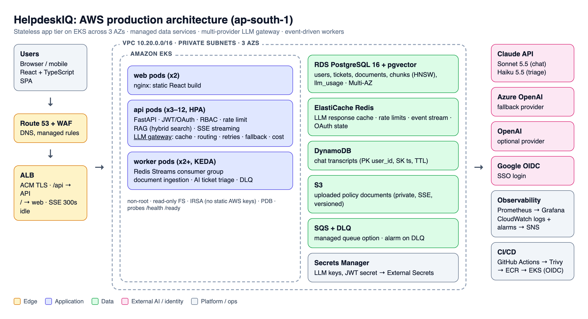
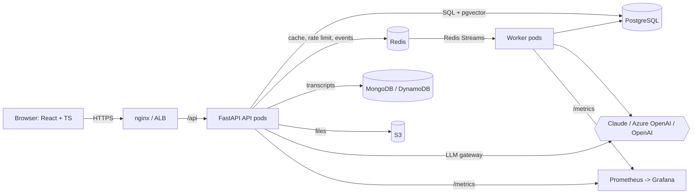

# HelpdeskIQ: AI Helpdesk Copilot

**Live demo:** https://helpdesk-iq.vercel.app (log in with a demo account below; the first request after idle can take ~1 minute while the free-tier API wakes up)

An internal IT & HR helpdesk where employees ask policy questions in chat (RAG over company documents, streamed answers with citations) and raise tickets that are **auto-categorised, prioritised and given a draft reply by AI**. Admins get a live view of **LLM cost, latency and cache hit rate**.

Built to show production-style **GenAI integration** in a full-stack app: Python/FastAPI, React/TypeScript, PostgreSQL + pgvector, Redis, MongoDB, Docker, Kubernetes, Terraform (AWS) and GitHub Actions.

| Area | What's implemented |
|---|---|
| **AI integration** | Multi-provider **LLM gateway**: Claude, OpenAI and Azure OpenAI (Strategy + Factory), plus an offline Mock |
| **Cost & performance** | Response cache (Redis), model routing (Sonnet for chat, Haiku for triage), skip the LLM when nothing relevant is retrieved, bounded history, per-call token/cost/latency accounting |
| **Reliability** | Retries with exponential backoff + jitter on 429/5xx, **provider fallback chain**, graceful degradation, **daily LLM budget cap** |
| **RAG** | Paragraph-aware chunking, embeddings, **hybrid retrieval** (pgvector HNSW + keyword rerank), cited, streamed answers (SSE) |
| **Structured output** | Ticket triage returns schema-validated JSON (category, priority, summary, reply) |
| **Security** | JWT access/refresh, **Google OAuth 2.0 / OIDC SSO**, RBAC (employee/agent/admin), row-level access, bcrypt, rate limiting, **PII redaction** before LLM calls, prompt-injection guard, upload validation, security headers |
| **Event-driven** | Uploads and tickets publish events; workers consume them via **Redis Streams consumer groups** (retries + dead-letter). SQS on AWS |
| **Data** | PostgreSQL (relational + vectors), MongoDB for chat transcripts (DynamoDB on AWS), S3 for files |
| **Observability** | JSON logs with request IDs, Prometheus metrics (HTTP + LLM tokens/cost/latency), `/health` + `/ready`, Grafana |
| **Testing** | 33 pytest tests (gateway, auth, RAG, tickets, RBAC), Vitest unit tests, 12 Playwright E2E tests (desktop + mobile) |
| **DevOps** | Multi-stage Dockerfiles (non-root), docker-compose, Kubernetes (HPA, PDB, probes, Ingress), Terraform for AWS, GitHub Actions (lint, test, E2E, Trivy scan, OIDC deploy) |

## Quick start

**Option A: full stack in Docker** (Postgres/pgvector, Redis, Mongo, API, 2 workers, web, Prometheus, Grafana)
```bash
cp .env.example .env          # add ANTHROPIC_API_KEY to use Claude; leave empty for the offline mock
make up                       # builds, starts, waits for health, seeds demo data
open http://localhost:8080    # app     |  http://localhost:8000/docs  (Swagger)
                              # metrics:   http://localhost:9090 (Prometheus), :3000 (Grafana)
make e2e                      # Playwright against the stack
```

**Option B: local dev, no Docker** (SQLite, in-memory cache/queue)
```bash
make setup && make seed
make dev-api      # terminal 1 -> :8000
make dev-web      # terminal 2 -> :5173
make test
```

Demo logins (password `Password123!`): `employee@helpdesk.io`, `agent@helpdesk.io`, `admin@helpdesk.io`

## Architecture





See [docs/ARCHITECTURE.md](docs/ARCHITECTURE.md), [docs/INFRA.md](docs/INFRA.md), [docs/DEMO_SCRIPT.md](docs/DEMO_SCRIPT.md) and [docs/DEPLOY_FREE.md](docs/DEPLOY_FREE.md) (free public demo on Vercel + Render + Neon).

## Project layout
```
backend/app/
  api/            auth (JWT + Google SSO), documents, chat (SSE), tickets, admin stats
  core/           config, security/RBAC, cache, rate limit, logging, metrics
  services/llm/   base (contracts + pricing), providers, factory, gateway
  services/       rag, triage, retrieval (hybrid), embeddings, guardrails, ingestion, events, storage
  repositories/   conversation repository (Mongo / in-memory)
  workers/        event handlers + Redis Streams consumer
frontend/src/     pages (Chat, Tickets, Knowledge base, Admin), Zustand auth store, React Query, SSE client
infra/            k8s manifests, terraform (AWS), prometheus/grafana
```

## Configuration
All settings come from environment variables (see `.env.example`). Switch providers without code changes:
```bash
LLM_PROVIDER=azure_openai LLM_FALLBACK_PROVIDERS=claude,mock
```
