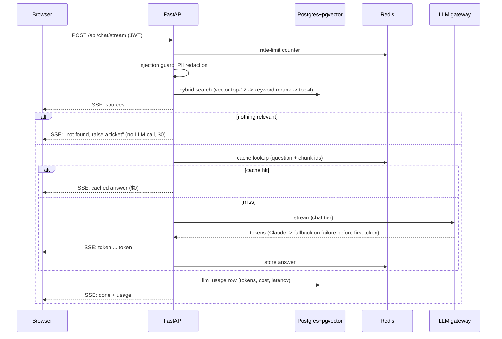
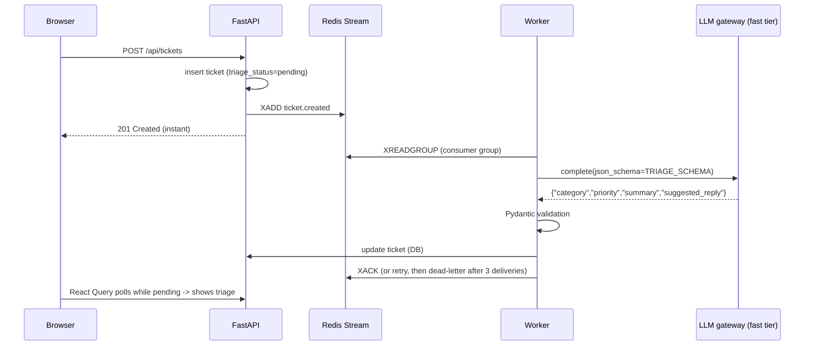

# Architecture & design decisions

## Request flows

### Chat (RAG, streamed)

### Ticket triage (event-driven)

## Key design decisions

| Decision | Why | Alternative considered |
|---|---|---|
| **LLM gateway with Strategy + Factory** | One place for retries, fallback, caching, cost tracking; vendors are swappable by config | Calling SDKs directly from features (duplicated logic, vendor lock-in) |
| **Retries in the gateway, SDK retries off** | Retries must compose with fallback; otherwise SDK retries + our fallback multiply latency | SDK default `max_retries=2` |
| **Fallback only before the first streamed token** | Once text reached the user, silently switching model mid-answer would produce an incoherent reply | Restart stream on another provider |
| **Don't cache fallback answers** | A degraded answer shouldn't be served under the primary's cache key after recovery | Cache everything |
| **FAQ cache key = normalised question + retrieved chunk ids** | Same question over the same evidence -> same answer for every user; invalidates automatically when documents change | Full-prompt hash (never hits once history differs) |
| **Skip LLM when retrieval finds nothing** | Zero cost and no hallucinated policy | Let the model say "I don't know" (costs tokens, may guess) |
| **Model routing by tier** | Triage is classification: Haiku is ~20x cheaper than Sonnet; chat quality matters more | One model for everything |
| **Hybrid retrieval** | Vectors catch paraphrases; keyword overlap keeps precision for exact terms (VPN, PAN, product names) | Pure vector search |
| **Async work via events (202 Accepted)** | Uploads and triage take seconds; the API stays fast and workers scale independently | Doing it in the request (slow, timeouts) |
| **Redis Streams consumer groups** | Already running Redis; at-least-once delivery, consumer groups, reclaim of stuck messages | Kafka (heavier ops), SQS on AWS (documented mapping) |
| **Idempotent handlers** | At-least-once delivery means duplicates happen; re-ingesting replaces chunks, re-triage overwrites | Exactly-once (expensive, rarely needed) |
| **Postgres + pgvector** | One database for relational data and vectors; transactions; HNSW index | Pinecone / OpenSearch (another system to run) |
| **MongoDB for transcripts** | Append-heavy, flexible per-message metadata, TTL; maps to DynamoDB (PK user_id, SK timestamp) | Postgres JSONB (works too; chosen to show NoSQL) |
| **Repository/adapter interfaces with in-memory fallbacks** | Local dev and tests run with zero infrastructure; prod swaps in Redis/Mongo/S3 | Requiring Docker for every test run |
| **JWT access (15 min) + refresh (7 days)** | Stateless API; short-lived access limits blast radius | Server sessions (sticky state) |
| **SSE over WebSockets for chat** | One-way token stream, works through proxies/ALB, simpler | WebSockets (bi-directional, not needed) |
| **Same-origin `/api` via nginx/ALB** | No CORS in prod, cookies/tokens simpler, one TLS cert | Separate API domain |

## Design patterns in the code
- **Strategy**: `LLMProvider` implementations (`services/llm/providers.py`)
- **Factory / registry**: `PROVIDERS` + `build_chain()` (`services/llm/factory.py`)
- **Repository**: `ConversationRepository` (Mongo / in-memory)
- **Adapter**: `Storage` (S3 / local disk), `Cache` (Redis / in-memory), `EventBus` (Redis Streams / in-process)
- **Dependency injection**: FastAPI `Depends` for DB sessions, current user, RBAC, rate limit; gateway takes cache/recorder/sleep as constructor args (easy to test)
- **Observer / pub-sub**: event bus + handlers registry
- **Template method-ish**: providers share `_params` / `_wrap` structure for request building and error mapping
