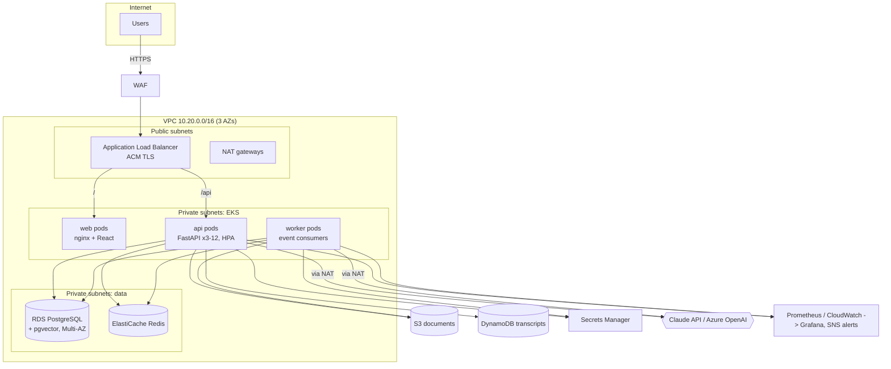

# HelpdeskIQ: Infrastructure & Deployment

## 1. Overview
HelpdeskIQ runs as three stateless workloads (React frontend, FastAPI API, event worker) on managed AWS data services. Everything is defined in code: **Docker** images, **Kubernetes** manifests (`infra/k8s`), **Terraform** (`infra/terraform/aws`) and **GitHub Actions** (`.github/workflows/ci.yml`). Region **ap-south-1 (Mumbai)**, the closest AWS region to Gurugram.

| Layer | Local (docker-compose) | AWS production | Azure equivalent |
|---|---|---|---|
| Edge / routing | nginx (`/api` proxy, SPA) | Route 53, ALB (AWS LB Controller), ACM TLS, WAF | Front Door / App Gateway + WAF |
| Frontend | nginx container | nginx pods on EKS (or S3 + CloudFront) | Static Web Apps / Container Apps |
| API | FastAPI container | EKS Deployment (3-12 pods, HPA) | AKS / Azure Container Apps |
| Worker | 2 worker containers | EKS Deployment (KEDA on queue depth) | Container Apps job / Functions |
| Relational + vectors | Postgres 16 + pgvector | RDS PostgreSQL Multi-AZ + pgvector | Azure Database for PostgreSQL Flexible (pgvector) |
| Cache / rate limit / stream | Redis 7 | ElastiCache Redis (2 nodes, TLS) | Azure Cache for Redis |
| NoSQL transcripts | MongoDB | DynamoDB (on-demand, TTL, PITR) | Cosmos DB |
| Files | Docker volume | S3 (private, versioned, SSE) | Blob Storage |
| Queue | Redis Streams | Redis Streams or SQS + DLQ | Service Bus |
| Secrets | `.env` | Secrets Manager -> External Secrets -> K8s Secret | Key Vault |
| LLM | Claude API (or mock) | Claude API; Azure OpenAI fallback | Azure OpenAI primary |
| Metrics / logs | Prometheus + Grafana | Amazon Managed Prometheus + Grafana, CloudWatch Logs | Azure Monitor / App Insights |
| Images | local build | ECR (immutable tags, scan on push) | ACR |
| CI/CD | n/a | GitHub Actions + OIDC to AWS | GitHub Actions / Azure DevOps |

## 2. Architecture diagram


## 3. Request and event flows
- **Chat:** ALB -> api pod -> rate limit (Redis) -> guardrails (PII, injection) -> hybrid retrieval (pgvector HNSW + keyword rerank) -> cache check (Redis) -> LLM gateway (stream) -> SSE back through ALB (idle timeout 300s, nginx `proxy_buffering off`).
- **Upload:** api validates type/size -> S3 -> `documents` row (`pending`) -> publishes `document.uploaded` -> **202 Accepted**. A worker downloads, extracts text, chunks, embeds, writes `chunks` and sets `ready`.
- **Ticket:** api inserts the ticket (`pending`) -> publishes `ticket.created` -> **201**. A worker runs triage on the fast model with a JSON schema, validates it and updates the ticket.
- **Delivery semantics:** at-least-once. Handlers are idempotent; failures are retried (pending entries reclaimed after 60s) and moved to a **dead-letter stream** after 3 deliveries (SQS: `maxReceiveCount=3` -> DLQ, CloudWatch alarm when the DLQ is non-empty).

## 4. Kubernetes (EKS)
- **Deployments:** `api` (3 replicas, RollingUpdate `maxUnavailable: 0`), `worker` (2), `web` (2).
- **Probes:** liveness `/health` (process only, so a DB blip doesn't restart pods), readiness `/ready` (DB + Redis; the pod leaves the load balancer when dependencies are down).
- **Autoscaling:** HPA on CPU 65% (3-12 api pods); workers scale on stream lag with KEDA; Cluster Autoscaler / Karpenter adds nodes.
- **Availability:** PodDisruptionBudget `minAvailable: 2`, pods spread across 3 AZs, Multi-AZ RDS, Redis replica with automatic failover.
- **Security:** non-root UID 10001, read-only root filesystem, all capabilities dropped, no privilege escalation; **IRSA** gives pods an IAM role (least-privilege S3/SQS/DynamoDB/Secrets) with no static AWS keys; secrets via External Secrets Operator.
- **Resources:** api requests 250m CPU / 384Mi, limits 1 CPU / 768Mi. Uvicorn runs 2 workers per pod; scale out with pods, not processes.

## 5. Terraform (`infra/terraform/aws`)
| File | Creates |
|---|---|
| `network.tf` | VPC across 3 AZs, public/private subnets, NAT per AZ in prod |
| `eks.tf` | EKS 1.31, managed node group (2-6 x t3.large), IRSA role + least-privilege policy, ECR repos (immutable, scan on push) |
| `data.tf` | RDS Postgres 16 (encrypted, Multi-AZ, 7-day backups, managed master password), ElastiCache Redis (TLS, at-rest encryption, failover), S3 (private, versioned, SSE), DynamoDB (on-demand, TTL, PITR), SQS + DLQ, Secrets Manager |
| `monitoring.tf` | CloudWatch log group (30-day retention), SNS alerts topic, DLQ and DB CPU alarms |

State lives in an S3 backend with DynamoDB locking (commented template in `versions.tf`). Environments (`dev`/`prod`) use the `environment` variable, which toggles Multi-AZ, NAT per AZ, deletion protection and final snapshots. Validated with `terraform validate` in CI.

## 6. CI/CD (GitHub Actions)
```
PR / push -> backend (ruff + 33 pytest) -> frontend (tsc + vitest + build) -> e2e (compose stack + Playwright)
          -> infra (terraform fmt/validate, kustomize build)
main      -> images: build -> Trivy scan (fail on HIGH/CRITICAL) -> push to ECR (tag = git SHA)
          -> deploy (manual approval via GitHub environment): kustomize set image -> kubectl apply -> rollout status
```
- **No long-lived cloud keys:** GitHub OIDC assumes an AWS deploy role.
- **Immutable artifacts:** the image tag is the commit SHA, so rollback is `kubectl rollout undo` or redeploying an earlier SHA.
- **Database migrations:** run Alembic as a pre-deploy Job with backward-compatible changes (expand -> deploy -> contract). The demo uses `create_all` for simplicity.

## 7. Security model
| Concern | Control |
|---|---|
| Authentication | JWT access (15 min) + refresh (7 days), token type checked; Google OAuth 2.0 / OIDC authorization-code flow with `state` (CSRF) and verified-email check |
| Authorisation | RBAC (`require_roles`) on routes plus row-level checks (employees see only their tickets; others' tickets return 404, not 403) |
| Passwords | bcrypt; same error for unknown email and wrong password (no account enumeration) |
| Input | Pydantic validation and length limits; upload allow-list (pdf/md/txt), 10 MB cap, path-traversal-safe storage keys |
| LLM-specific | PII redaction (email, phone, PAN, Aadhaar, card) before any provider call; prompt-injection patterns blocked; retrieved docs wrapped in tags and declared as data in the system prompt; output for triage schema-validated |
| Abuse / cost | Per-user rate limit (Redis) on LLM endpoints; per-call cost tracking and alerting |
| Transport / edge | TLS at ALB (ACM), WAF managed rules, security headers (nosniff, frame deny, no-referrer) |
| Data at rest | RDS, Redis, S3 and DynamoDB encryption; S3 public access blocked |
| Secrets | Secrets Manager / Key Vault, never in images or git (`.env` gitignored) |
| Supply chain | Pinned dependencies, Trivy image scan, ECR scan on push, non-root containers |
| Token storage trade-off | Demo keeps tokens in localStorage for simplicity. In production, use an httpOnly, Secure, SameSite refresh cookie with an in-memory access token to reduce XSS exposure |

## 8. Scalability & performance
- **Stateless API:** all state is in Postgres/Redis/Mongo, so pods scale horizontally behind the ALB.
- **Async offloading:** slow work (embedding, triage) runs in workers; API p95 stays low.
- **Vector search:** HNSW index (`vector_cosine_ops`) gives sub-linear ANN search; hybrid rerank only touches the top 12 candidates.
- **DB:** connection pooling (`pool_size=10`, `pre_ping`), indexes on `tickets(created_by, status, created_at)`, `documents(status)`, `chunks(document_id)`; RDS read replica for the admin analytics if needed; RDS Proxy to cap connections as pods scale.
- **Caching:** LLM answers (1 hour TTL), static assets (`Cache-Control: immutable` for hashed bundles).
- **Streaming:** SSE gives the first token in ~1s even when a full answer takes several seconds.

## 9. Observability
- **Logs:** structured JSON with `request_id` (propagated through `X-Request-ID`), shipped to CloudWatch. Every LLM call logs provider, model, tokens, cost, latency, cache hit and fallback.
- **Metrics (Prometheus):** `http_requests_total`, `http_request_duration_seconds`, `llm_requests_total{provider,model,task,outcome}`, `llm_tokens_total`, `llm_cost_usd_total`, `llm_latency_seconds`, `llm_cache_total`, `events_processed_total`.
- **Alerts:** LLM error rate > 5% (5 min), LLM spend > $5 per hour, API p95 > 1s, DLQ not empty, RDS CPU > 80%.
- **Tracing (next step):** OpenTelemetry FastAPI instrumentation -> AWS X-Ray / Tempo; one span per LLM call.

## 10. LLM cost model (illustrative estimate)
Prices (USD per 1M tokens): Claude Sonnet 5.5 $2 input / $10 output; Claude Haiku 5.5 $0.10 / $0.50.

| Call | Input tokens | Output tokens | Model | Cost per call |
|---|---|---|---|---|
| Chat answer | ~1,500 (system 200 + 4 chunks 600 + bounded history 500 + question) | ~250 | Sonnet 5.5 | **$0.0055** |
| Ticket triage | ~700 | ~150 | Haiku 5.5 | **$0.000145** |

**Scenario:** 2,000 employees x 3 questions per working day = 6,000 questions/day; 300 tickets/day; 22 working days.

| | Naive (no optimisation) | HelpdeskIQ |
|---|---|---|
| Chat calls reaching the LLM | 6,000/day (full history ~3,000 tokens in) | 6,000 x (1 - 10% no-context skip - 30% cache hits) ≈ 3,600/day |
| Chat cost/day | 6,000 x $0.0085 = $51.00 | 3,600 x $0.0055 = $19.80 |
| Triage cost/day (Sonnet vs Haiku) | 300 x $0.0029 = $0.87 | 300 x $0.000145 = $0.04 |
| **Monthly (22 days)** | **≈ $1,141** | **≈ $437 (about 62% lower)** |

Further levers: Anthropic prompt caching for the static system prompt, a lower `max_tokens`, the Batch API (50% cheaper) for non-urgent re-triage, a semantic (embedding-similarity) cache, and per-department budgets with alerts.

## 11. Reliability & disaster recovery
- **LLM outage:** retries (429/5xx with backoff + jitter) -> fallback provider (Azure OpenAI) -> mock/"raise a ticket" message. The UI never hard-fails.
- **AZ failure:** Multi-AZ RDS, Redis failover, pods spread across 3 AZs, NAT per AZ.
- **Backups:** RDS automated backups (7 days) + snapshots; S3 versioning; DynamoDB point-in-time recovery.
- **Targets:** RPO ≤ 5 min (RDS PITR), RTO ≤ 30 min (re-provision from Terraform + restore).
- **Deploy safety:** rolling updates with readiness gates, zero-unavailable surge, `rollout status` gate, one-command rollback.

## 12. Trade-offs & next steps
- Embeddings use a local hashing embedder so the demo runs offline. For production, swap in a hosted embedding model (OpenAI `text-embedding-3-small`, Azure OpenAI or Bedrock Titan) through the `Embedder` interface and re-index.
- `create_all` -> Alembic migrations.
- Add OpenTelemetry tracing and an LLM evaluation set (golden Q&A pairs scored in CI) to catch prompt regressions.
- Move refresh tokens to httpOnly cookies; add refresh-token rotation and revocation (Redis denylist).
- Multi-tenant support (tenant_id on every row + Postgres row-level security) if offered to several client companies.
